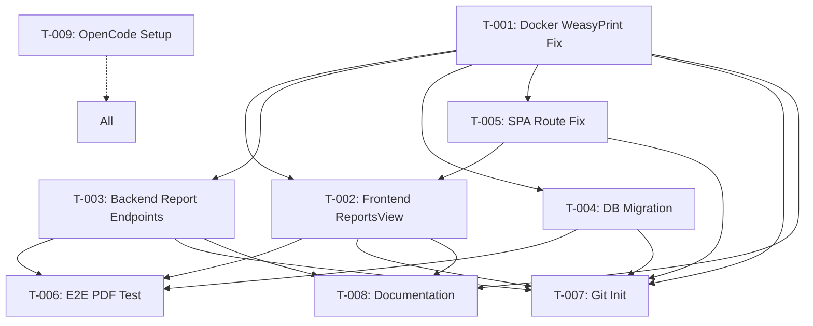

# DRISHTI Dependency Graph

## Task Dependencies

## Critical Path
T-001 → T-003 → T-006 (PDF generation flow)

## Parallel Groups

### Group A (after T-001)
- T-002 (Frontend ReportsView)
- T-003 (Backend Endpoints) 
- T-004 (DB Migration)
- T-005 (SPA Route Fix)

### Group B (after Group A)
- T-006 (E2E PDF Test)
- T-008 (Documentation)

### Group C (after all P0)
- T-007 (Git Init)

## Independent Tasks
- T-005 (curezy.in DNS) - operational, independent
- T-009 (OpenCode Setup) - can run in parallel with all

## Blocked Tasks
- T-005 (curezy.in DNS): All existing authorizations expired, requires manual DNS TXT record creation and propagation

## Resource Conflicts
- **Files**: T-002 and T-005 both touch `backend/main.py` (different sections)
- **Docker**: T-001 rebuild affects all subsequent container tests
- **Database**: T-004 migration must complete before T-006 tests

## Execution Order Recommendation
1. T-001 (Docker) - MUST complete first
2. T-003, T-004, T-005 (parallel) - Backend fixes
3. T-002 (Frontend) - depends on T-005 for API access
4. T-006 (E2E Test) - validates integration
5. T-008 (Documentation) - captures final state
5. T-007 (Git Init) - final checkpoint
6. T-009 (OpenCode Setup) - ongoing