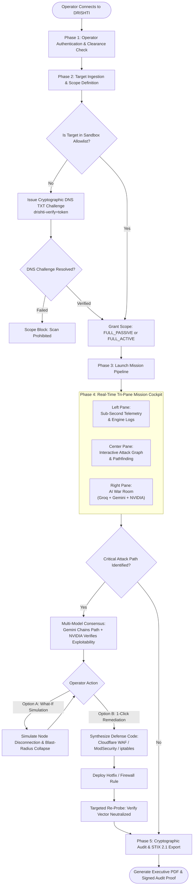

# DRISHTI Cyber Intelligence Platform — UI/UX & System Architecture Specification

**Document Version:** 2.0.0  
**Classification:** Engineering Specification // SEC-ARCH-09  
**System Target:** Production-Grade Tactical Cyber Command Center  

---

## 1. Executive Overview & Design Philosophy

DRISHTI is engineered as a high-density, real-time **Cyber Intelligence Operations Deck (SecOps C2 HUD)**. It moves away from generic, fragmented multi-tab dashboards into a unified **Tri-Pane Spatial Cockpit** designed for rapid threat identification, topological attack graph exploration, and 1-click autonomous remediation.

### Core Visual Principles
- **Aesthetic Identity:** Tactical Obsidian HUD (Military/Aerospace Cyber Defense tier).
- **High Signal-to-Noise Ratio:** Zero decorative padding or generic filler charts. Every pixel represents active network state, protocol telemetry, or exploitable risk.
- **Zero Layout Shifts:** Fixed spatial grid anchors ensure streaming data arrives without jarring page reflows or component jumps.
- **Micro-Interactions & Physics:** Tactile feedback on actions, spring physics for node transitions, and subtle auditory cues on critical finding discoveries.

### Tactical Color Palette

| Token Name | Hex Code | Visual Meaning & Role |
| :--- | :--- | :--- |
| **Canvas Base** | `#090d16` | Deep Obsidian background for visual comfort during long operational sessions. |
| **Surface Panel** | `#0f172a` / `#1e293b` | Tactical slate panels with 1px translucent borders (`#334155`). |
| **Telemetry Cyan** | `#06b6d4` | Passive reconnaissance, DNS records, TLS handshake inspection, and active listening. |
| **Defensive Emerald**| `#10b981` | Cryptographically verified DNS authorization, hardened endpoints, and confirmed patches. |
| **Warning Amber** | `#f59e0b` | Service information leakage, deprecated TLS ciphers, and medium-severity exposures. |
| **Weaponized Rose** | `#f43f5e` | Confirmed critical CVEs, weaponized exploit chains, and unmitigated attack paths. |

### Typography Matrix
- **UI Chrome, Controls & Headers:** `Inter` or `Geist Sans` (`-0.015em` letter-spacing, high legibility).
- **Data, Packets, Payloads & Hashes:** `JetBrains Mono` with tabular numbers enabled (`font-variant-numeric: tabular-nums`).

---

## 2. Spatial Layout & Tri-Pane Cockpit Architecture

The interface is structured into four persistent spatial layers:

```
┌──────────────────────────────────────────────────────────────────────────────────────────────────┐
│ LAYER 1: TOP TACTICAL APP BAR & MISSION HUD                                                      │
├────────────────────────────────┬────────────────────────────────┬────────────────────────────────┤
│ LAYER 2 (LEFT - 30%):          │ LAYER 2 (CENTER - 45%):        │ LAYER 2 (RIGHT - 25%):         │
│ TELEMETRY & ENGINE STREAM      │ DYNAMIC ATTACK GRAPH CANVAS    │ AUTONOMOUS AI WAR ROOM         │
│                                │                                │                                │
│ [Stage Pipeline Progression]   │ [Force-Directed Surface Map]   │ [Groq/Gemini Streaming Stream] │
│ - Ingress -> DAST -> Nuclei    │ - Ingress to Crown Jewels Path │ - Multi-vector Exploit Chain   │
│                                │ - Node Blast Radius Highlighting│                                │
│ [Live Sub-Second Event Log]    │ - "What-If" Mitigation Toggles │ [1-Click Remediation Deck]     │
│ - HTTP status, banners, routes │                                │ - Cloudflare WAF Rule Tab      │
│                                │ [Selected Node Inspector]      │ - ModSecurity / iptables Tab   │
│ [Discovered Service Matrix]    │ - Port, service banner, CVEs   │ - Dockerfile / Code Patch Tab  │
│ - Ports, protocols, TLS flags  │ - Evidence payload viewer      │ [Verify Neutralization Button] │
├────────────────────────────────┴────────────────────────────────┴────────────────────────────────┤
│ LAYER 3: BOTTOM SYSTEM TELEMETRY DOCK (Supabase WebSocket Pulse | Concurrency | Audio Alerts)   │
└──────────────────────────────────────────────────────────────────────────────────────────────────┘
```

### Layer 1: Top Tactical App Bar (Global Mission HUD)
1. **Target Ingress Switcher:** Quick-select dropdown with active domain (e.g., `vvdx.in`) and status indicator.
2. **Cryptographic Scope Badge:** Indicates verified authorization level:
   - `[FULL_PASSIVE]` (Cyan pill) — Non-intrusive reconnaissance & header auditing.
   - `[FULL_ACTIVE]` (Purple pill) — Port probing, Nuclei vulnerability testing, and fuzzing.
3. **Threat Level Radar:** Aggregated real-time risk dial (`CVSS / EPSS Composite: 7.8/10 CRITICAL`) with a pulsating ambient ring.
4. **Mission Controls:**
   - `[LAUNCH MISSION]` (`⌘ + Enter`) — Triggers asynchronous engine execution.
   - `[KILL SWITCH]` — Immediate abort signal terminating all background socket probes.
   - `[COMMAND PALETTE]` (`⌘K`) — Global spotlight search for nodes, CVEs, or quick actions.

### Layer 2: The Tri-Pane Cockpit Core

#### Left Pane (30%): Telemetry & Engine Stream
- **Pipeline Stage Stepper:** Visual tracking of the 5-phase engine sequence:
  1. `Ingress Detective` → 2. `Protocol & Ports` → 3. `Pure DAST` → 4. `Nuclei Patterns` → 5. `Attack Graph`.
- **Sub-Second Streaming Log:** High-density monospace event stream updating via Supabase Realtime WebSockets with category filters (`ALL`, `PORTS`, `HTTP`, `CVE`, `WARNINGS`).
- **Service & Port Discovery Matrix:** Compact table displaying open ports, service banners (e.g., `nginx 1.24.0`, `OpenSSH 8.9p1`), TLS cipher suite ratings, and cookie flags (`HttpOnly`, `Secure`, `SameSite`).

#### Center Pane (45%): Dynamic Attack Graph Canvas
- **Topological Force-Directed Canvas:** Translates disconnected scanner findings into an interactive dependency graph with distinct visual tiers:
  - `Internet Ingress` (Public Entrypoint)
  - `Edge / WAF` (Cloudflare / Reverse Proxy)
  - `Application Microservices` (FastAPI, Node.js, Spring)
  - `Crown Jewels` (Production Database, Redis, Secrets Vault)
- **Critical Attack Path (Dijkstra Highlighting):** Automatically computes and highlights the shortest exploitable path to compromise with an animated crimson energy beam.
- **"What-If" Defense Simulation Bar:** Interactive toggle chips representing discovered vulnerabilities. Clicking "Simulate Patching CVE-2024-XXXX" instantly recomputes the graph and shows the attack path dissolve.
- **Selected Node Inspector Drawer:** Slide-up panel displaying raw HTTP evidence, CVSS v3.1 vector strings, and EPSS weaponization probabilities.

#### Right Pane (25%): Autonomous AI War Room
- **Streaming Threat Narrative:** Multi-model AI explanation stream (Groq LPU + Gemini + NVIDIA NIM) providing evidence-grounded analysis covering:
  1. *Initial Ingress Vector*
  2. *Lateral Pivot Hypothesis*
  3. *Decisive Impact / Data Breach Risk*
- **1-Click Remediation Deck:** Copy-pasteable defensive counter-measures synthesized on demand:
  - **Tab 1:** Cloudflare WAF Expression Rule.
  - **Tab 2:** Nginx / Apache ModSecurity Directive.
  - **Tab 3:** Linux `iptables` / `nftables` Drop Commands.
  - **Tab 4:** Code / Dockerfile Dependency Upgrade Diff.
- **Verify Neutralization Trigger:** One-click action that dispatches a targeted micro-probe to confirm the vector is closed.

### Layer 3: Bottom System Telemetry Dock
- **Supabase Realtime Sync Pulse:** Visual beacon showing WebSocket mesh latency (e.g., `CONNECTED // 14ms`).
- **Hardware & Concurrency Monitor:** Concurrency counters, memory footprint, and engine health status.
- **Audio Alert Toggle:** Operator control for auditory alarms on critical CVE detection.

---

## 3. End-to-End User Operational Flow



---

## 4. Multi-API Synergy Matrix (The "Undefeatable" Advantage)

DRISHTI leverages its configured API ecosystem to achieve capabilities beyond traditional static scanners:

| API / Provider | Model / Endpoint | Role in DRISHTI | Technical Impact |
| :--- | :--- | :--- | :--- |
| **Supabase** | PostgreSQL + Realtime WebSockets | Live State Data Plane | Provides sub-50ms distributed state updates to all connected operators with zero page refreshes and strict multi-tenant Row-Level Security (RLS). |
| **Groq API** | `llama-3.3-70b-versatile` on LPU | Sub-Second Telemetry Triage | Ingests raw HTTP packets and service banners at >500 tokens/sec (<150ms TTFT), flagging WAF evasions and anomalous headers while the scan is running. |
| **Google Gemini API** | `gemini-1.5-pro` / `gemini-2.5` | Whole-Surface Exploit Chaining | Processes the entire attack surface simultaneously using its multi-million token context window, identifying chained vulnerabilities across disparate services. |
| **NVIDIA NIM API** | `meta/llama-3.1-70b-instruct` | Exploitability & False-Positive Filter | Evaluates target environment constraints (unprivileged containers, ASLR, OS version) to eliminate false positives and verify weaponization likelihood. |
| **Hugging Face** | Embedding Models & Hub APIs | Zero-Day & KEV Vector Search | Performs sub-10ms semantic vector lookups over the CISA Known Exploited Vulnerabilities catalog to match obscure banners to active zero-day exploits. |

---

## 5. File & Directory Structure

### Frontend Structure (`frontend/src/`)
```
frontend/src/
├── App.tsx                             # Master layout shell & WebSocket lifecycle manager
├── main.tsx                            # Root entry point
├── types.ts                            # Unified TypeScript schemas
├── index.css                           # Tactical Obsidian tokens & animations
│
├── api/                                # Data Transport Layer
│   ├── client.ts                       # Axios / Fetch client with JWT interceptors
│   ├── sse.ts                          # Server-Sent Events consumer
│   └── supabase.ts                     # Supabase JS Client & Realtime channel bindings
│
├── hooks/                              # Reactive State & Real-Time Hooks
│   ├── useTelemetry.ts                 # Live probe logs & phase progression stream
│   ├── useAttackGraph.ts               # Graph topology state & Dijkstra shortest path
│   ├── useAiCopilot.ts                 # Streaming Groq/Gemini exploit narratives
│   └── useSupabaseSync.ts              # Real-time multi-operator synchronization
│
├── components/                         # UI Building Blocks
│   ├── layout/
│   │   ├── TopCommandBar.tsx           # Target switcher, Scope badge, Threat Score HUD
│   │   ├── BottomTelemetryDock.tsx     # Memory, engine concurrency, Supabase sync pulse
│   │   └── CommandPalette.tsx          # ⌘K / Ctrl+K keyboard shortcut launcher
│   │
│   ├── cockpit/                        # The Tri-Pane Core
│   │   ├── TelemetryStreamPane.tsx     # (Left 30%) Live sub-second packet/header findings
│   │   ├── AttackGraphCanvas.tsx       # (Center 45%) Interactive physics graph & blast rings
│   │   └── AiWarRoomPane.tsx           # (Right 25%) Live LLM Explainer & 1-Click WAF generator
│   │
│   ├── defense/                        # Autonomous Mitigation Modals
│   │   ├── WafRuleModal.tsx            # Cloudflare / Nginx ModSecurity rule exporter
│   │   ├── PatchDiffViewer.tsx         # Dockerfile / Code-level PR remediation diffs
│   │   └── WhatIfSimulator.tsx         # Interactive node mitigation simulator
│   │
│   └── common/                         # Atomic Controls
│       ├── MetricBadge.tsx             # CVSS/EPSS reactive threat pills
│       ├── CodeBlock.tsx               # Monospace syntax-highlighted payload viewer
│       └── Toast.tsx                   # Hardware-accelerated notifications
│
└── views/                              # 4 Primary Operational Theaters
    ├── CommandDeckView.tsx             # The Primary Cockpit (Tri-Pane Live Mission Control)
    ├── AttackGraphView.tsx             # Dedicated Fullscreen Deep Graph Inspection
    ├── AutonomousDefenseView.tsx       # Remediation Matrix (Firewall rules, Patches, Verification)
    └── ComplianceAuditView.tsx         # Immutable SQLite WAL & Supabase cryptographically signed logs
```

### Backend Structure (`backend/`)
```
backend/
├── main.py                             # FastAPI gateway with lifespan events & CORS
│
├── api/                                # REST & Streaming Endpoints
│   ├── routes.py                       # Master API router
│   ├── auth.py                         # Operator JWT authentication
│   ├── authorizations.py               # DNS challenge & scope boundary enforcement
│   ├── scans.py                        # Scan initiation, abort, and status endpoints
│   ├── graph.py                        # Attack graph topology & critical path queries
│   ├── llm.py                          # Multi-model streaming endpoints (Groq/Gemini/NVIDIA)
│   ├── defense.py                      # WAF, iptables, and patch generation endpoints
│   ├── sse.py                          # SSE event multiplexer
│   └── settings.py                     # API key management and provider switches
│
├── services/                           # Intelligence & Engine Services
│   ├── llm_router.py                   # Circuit-breaker router (Groq -> Gemini -> NVIDIA NIM)
│   ├── llm_models.py                   # Pydantic schemas for LLM prompts and roles
│   ├── intelligence_explainer.py       # Evidence-grounded attack path narrative synthesizer
│   ├── remediation_engine.py           # Generates exact WAF rules, iptables & patch code
│   ├── supabase_sync.py                # Publishes scan events to Supabase Realtime WebSockets
│   ├── cve_matcher.py                  # Matches port banners against local NVD database
│   ├── nvd_client.py                   # Caching client for NVD / CISA KEV feeds
│   ├── scan_orchestrator.py            # Phase 1-5 pipeline coordinator
│   ├── graph_builder.py                # Constructs network-to-application topological graphs
│   ├── graph_service.py                # Dijkstra weighted pathfinding (Ingress -> Crown Jewels)
│   ├── risk_engine.py                  # CVSS v3.1 + EPSS risk calculation
│   ├── detective.py                    # DNS, IP, and subresource detective engine
│   └── scope.py                        # Scope boundary guardrails (SSRF & subnet protection)
│
├── engines/                            # Native Pure-Python High-Performance Engines
│   ├── __init__.py
│   ├── async_port_engine.py            # High-speed native TCP/UDP socket scanner
│   ├── async_httpx_engine.py           # Protocol & TLS fingerprinting engine
│   ├── pure_dast_engine.py             # Passive & active DAST header/cookie auditor
│   ├── pure_nuclei_engine.py           # Lightweight vulnerability pattern matching
│   └── pure_trivy_engine.py            # Client-side dependency & CVE correlation engine
│
├── db/                                 # Persistence
│   └── database.py                     # Dual-mode SQLite WAL (Local) + Supabase PostgreSQL
│
└── templates/                          # Export Formats
    └── reports/
        └── security_report.html        # STIX 2.1 & Executive PDF report template
```

---

## 6. Micro-Interactions & UI Motion Specifications

| Interaction Event | Component Target | Visual & Sensory Behavior | Motion Parameters |
| :--- | :--- | :--- | :--- |
| **New Finding Discovered** | Telemetry Row & Node | Flashes crimson accent border; node in center canvas scales up by 15% and emits a ripple wave. | `spring(stiffness: 320, damping: 22)` |
| **Critical Attack Path Identified** | Attack Graph Edges | Directed edge strokes morph from subtle gray to pulsating crimson energy beam. | SVG stroke-dashoffset animation at `2.4s` linear loop |
| **What-If Node Toggled Off** | Attack Graph Node | Target node dims to 20% opacity; connected crimson attack edge dissolves into emerald. | `transition: opacity 250ms ease-out` |
| **Remediation Copied** | Remediation Deck | Clipboard icon morphs to emerald checkmark with subtle tactile click feedback. | Reset to default icon after `1500ms` |
| **Pane Resize / Collapse** | Cockpit Dividers | Double-clicking divider folds pane into an icon rail with zero layout shifting. | `cubic-bezier(0.16, 1, 0.3, 1)` across `200ms` |
